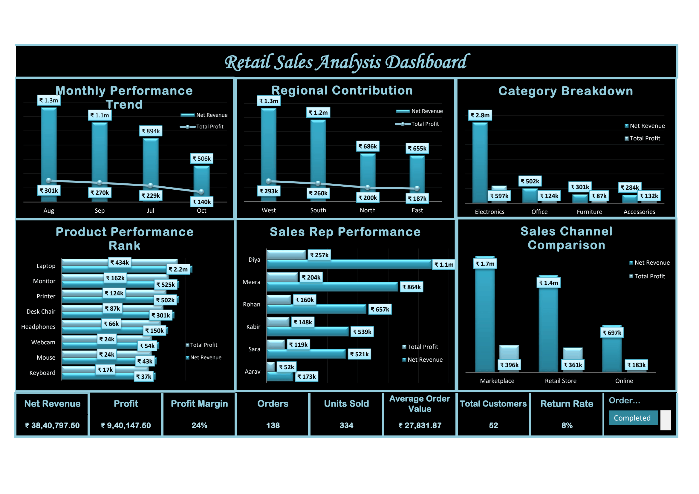

# Retail Performance Dashboard 📊

An Excel-based data analytics project focused on analyzing retail sales performance, revenue, profitability, and customer activity.

## 📌 Project Overview

This project analyzes a synthetic retail orders dataset to identify business performance trends and provide useful insights through an interactive Excel dashboard.

## 🎯 Business Objectives

- Analyze overall sales and revenue performance.
- Measure profitability across products and regions.
- Track completed and returned orders.
- Understand customer purchasing patterns.
- Present key business metrics in an interactive dashboard.

## 🛠️ Tools & Technologies

- Microsoft Excel
- PivotTables
- PivotCharts
- Slicers
- Excel formulas
- Data cleaning and analysis

## 📈 Key Performance Indicators

- Net Revenue
- Total Profit
- Profit Margin
- Completed Orders
- Units Sold
- Average Order Value (AOV)
- Unique Customers
- Return Rate

## 📊 Project Results

| Metric | Result |
|---|---:|
| Total Orders | 150 |
| Completed Orders | 138 |
| Returned Orders | 12 |
| Net Revenue | ₹38,40,797.50 |
| Total Profit | ₹9,40,147.50 |
| Return Rate | 8% |

*Revenue and profit figures are calculated using completed orders.*

## 🖥️ Dashboard Preview

## 📁 Repository Contents

- `Retail_Performance_Dashboard.xlsx` — Completed Excel dashboard and analysis.
- `retail_performance_dashboard_practice.xlsx` — Original synthetic dataset.
- `dashboard-preview.png` — Dashboard screenshot.

## 💡 Skills Demonstrated

- Data cleaning and preparation
- Excel formulas and calculations
- KPI development
- Business data analysis
- PivotTable and PivotChart creation
- Interactive dashboard development
- Business insights and reporting

## 👨‍💻 About This Project

This is a portfolio project created as part of my journey into Data Analytics. It demonstrates my ability to transform raw retail data into meaningful business information using Microsoft Excel.

